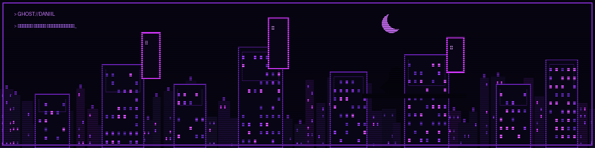
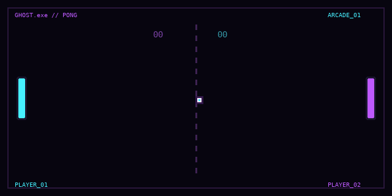

<div align="center">



# `GHOST.exe`

### `> connection_established`

**Привет! Я rabochuiDK - начинающий разработчик.**

`CYBERPUNK` · `PIXEL ART` · `CODE & CURIOSITY`

[](https://github.com/rabochuiDK)

</div>

---

```text
┌─ GHOST TERMINAL ─────────────────────────────┐
│ STATUS  : ONLINE                             │
│ ROLE    : BEGINNER DEVELOPER                 │
│ FOCUS   : LEARN / PRACTICE / IMPROVE         │
│ NEXT    : TURN KNOWLEDGE INTO PROJECTS       │
└──────────────────────────────────────────────┘
```

## `01 // ABOUT ME`

- 👨‍💻 Я только начинаю путь в разработке и постепенно набираюсь опыта.
- 🌌 Нравятся киберпанк-атмосфера, неон и пиксельная эстетика.
- 🧩 Сейчас моя цель - закреплять основы на практике и со временем создавать собственные проекты.
- 🚧 Пока нет больших завершённых проектов - и это нормально: я учусь и двигаюсь шаг за шагом.

> *Every system has a hidden side.*

## `02 // SKILL TREE`

<div align="center">

**LEARNED / STUDIED**


**CURRENTLY LEARNING**


</div>

- **C++** - изучил основы.
- **JavaScript** - изучаю сейчас.
- **HTML** - осваиваю разметку веб-страниц.
- **Node.js** - изучаю среду для запуска JavaScript вне браузера.

## `03 // PROJECTS`

Пока здесь нет крупных самостоятельных проектов - я ещё учусь. Вместо пустых карточек и выдуманных достижений оставляю этот раздел для будущих работ.

```text
[ PROJECTS: IN DEVELOPMENT ]
> learning the basics...
> practicing regularly...
> building the first real project...
```

Когда появится проект, здесь можно добавить его название, описание и ссылку на репозиторий.

## `04 // GITHUB SIGNAL`

<div align="center">


</div>

<sub>Статистика формируется сторонним сервисом по публичным данным GitHub. Если карточки временно не загружаются, попробуй открыть профиль позже - это не мешает работе самого профиля.</sub>

## `05 // ARCADE`

<div align="center">

**GHOST PONG // AUTOPLAY**



`BALL: IN MOTION` · `PADDLES: ACTIVE` · `LOOP: ∞`

</div>

---

<div align="center">

`END OF TRANSMISSION` · **Спасибо, что заглянул.**

</div>
